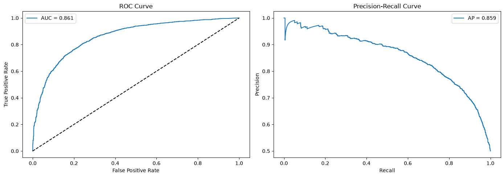
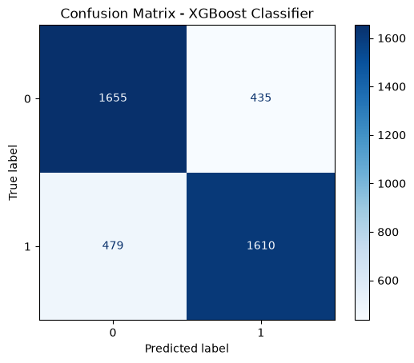
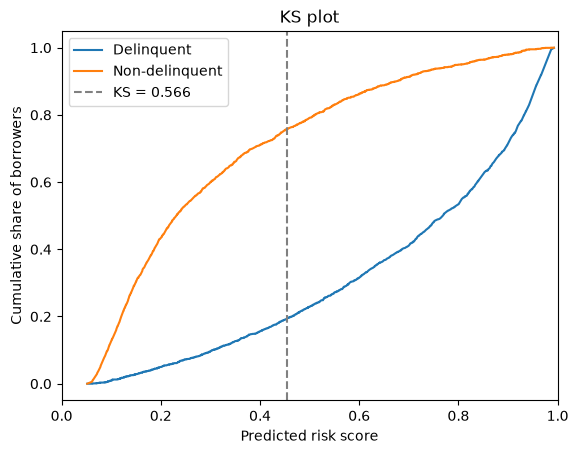
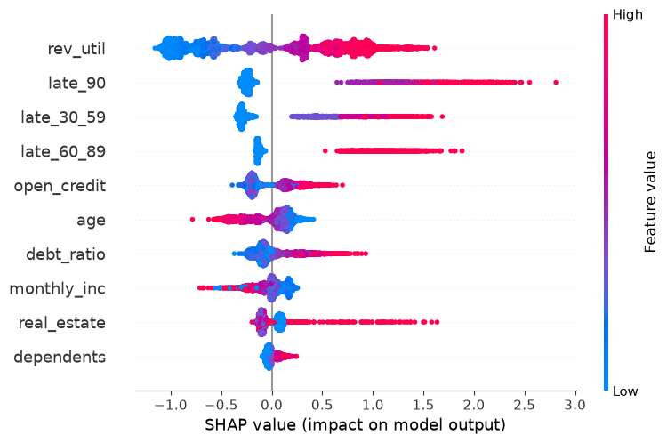
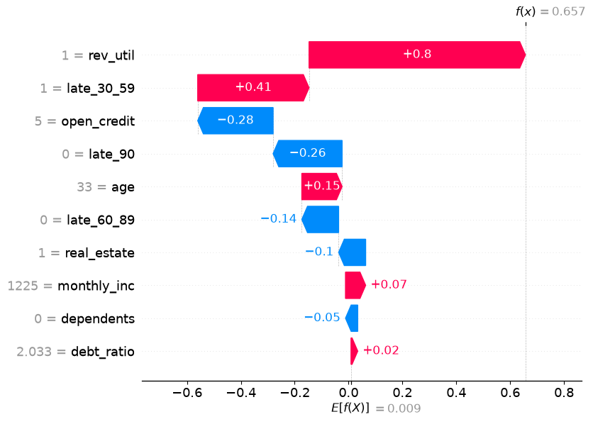
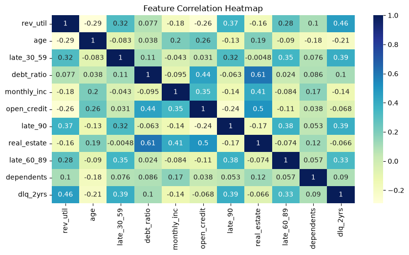

# Credit Risk Prediction

Predicts whether a borrower will have a serious delinquency within the next two years, from 10 credit and income features.

**Result:** XGBoost reached a test PR-AUC of **0.859**, ROC-AUC of **0.861** (Gini 0.722), KS of **0.566** and recall of **0.771** on a held-out set. Chance level for PR-AUC and ROC-AUC is 0.50 on this balanced dataset.

**Stack:** Python, pandas, NumPy, scikit-learn, XGBoost, SHAP, matplotlib, seaborn, joblib

[View the notebook](Credit-Risk-Prediction.ipynb)

## Problem

Lenders need to identify borrowers likely to fall seriously behind on payments. This is framed as binary classification on `dlq_2yrs`, with PR-AUC as the main metric because it measures how well the model ranks the risky class.

## Data

[Credit Risk Benchmark Dataset](https://www.kaggle.com/datasets/adilshamim8/credit-risk-benchmark-dataset) (Kaggle): 16,714 borrowers, 10 features, split evenly between the two classes (8,357 each).

| Column | Description |
|---|---|
| `rev_util` | Ratio of revolving credit utilization (balance/credit limit) |
| `age` | Age of the borrower |
| `late_30_59` | Number of times 30–59 days past due (worse than current) |
| `late_60_89` | Number of times 60–89 days past due (worse than current) |
| `late_90` | Number of times 90 days or more late on a payment |
| `debt_ratio` | Debt to income (or assets) ratio |
| `monthly_inc` | Monthly income of the borrower |
| `open_credit` | Number of open credit lines and loans |
| `real_estate` | Number of real estate loans or credit lines |
| `dependents` | Number of dependents |
| `dlq_2yrs` | Target: serious delinquency in the next 2 years (0 = No, 1 = Yes) |

## Approach

1. **EDA:** checked class balance, missing values, duplicates, distributions, outliers, placeholder values and correlations.
2. **Preprocessing:** applied `log1p` and standard scaling inside a scikit-learn `Pipeline`, so each transform is fitted on training folds only and cannot leak test data.
3. **Split:** stratified 75/25 train/test split (12,535 / 4,179 rows).
4. **Modeling:** tuned Logistic Regression (L1 and L2) and XGBoost with `RandomizedSearchCV`, using 10-fold cross-validation scored on average precision.
5. **Selection:** kept XGBoost, which led on both cross-validation and the test set.
6. **Risk analysis:** reported recall, a confusion matrix and KS, and used SHAP to explain the model's predictions.
7. **Inference:** saved the full pipeline with joblib, reloaded it and scored example borrowers.

## Results

| Metric | Logistic Regression | XGBoost |
|---|---|---|
| PR-AUC, 10-fold CV | 0.844 | **0.858** |
| PR-AUC, test | 0.851 | **0.859** |
| ROC-AUC, test | 0.854 | **0.861** |
| Gini, test (2 × AUC − 1) | 0.708 | **0.722** |
| F1 at 0.5 threshold, test | 0.765 | **0.779** |

Best settings:

- **XGBoost:** `n_estimators=100`, `max_depth=3`, `learning_rate=0.1`
- **Logistic Regression:** L1 penalty, `C=100`

The small gap between the two models suggests a linear model already captures much of the signal.



### Recall and errors

At the default 0.5 threshold, XGBoost's recall is 0.771. It catches 1,610 of 2,089 delinquent borrowers and misses 479, while wrongly flagging 435 of 2,090 non-delinquent borrowers.



### KS

KS is the largest gap between the cumulative score distributions of delinquent and non-delinquent borrowers. For XGBoost it was **0.566**, at a score of 0.453. That score is where the two groups separate most, not a recommended approval cutoff.



## What drives the model

SHAP values on the test set show how each feature moved a score, in log-odds:

- **Revolving utilization:** `rev_util` has the largest overall impact. High utilization raises risk and low utilization lowers it.
- **Payment history:** any late payment raises risk sharply, and `late_90` has the largest individual effects. Having no late payments lowers risk only slightly.
- **Income, debt and age:** higher income and older age lower predicted risk, while a higher debt ratio raises it.

`rev_util` also has the strongest Spearman correlation with the target (0.46), so the two views agree.



In the example below, a borrower scores 0.657 log-odds, or about 66% against a base of 50%. Maxed-out utilization (+0.80) and one 30–59 day late payment (+0.41) raise the score, while five open credit lines (−0.28) and no 90-day late payments (−0.26) lower it.



## EDA findings

- The data has no missing values and 2 duplicate rows, which were kept because there is no borrower ID to confirm they are the same person.
- Most features are strongly right-skewed, and `rev_util` and `debt_ratio` reach about 22,000 and 60,000. Outliers were kept because they may be linked to delinquency.
- Spearman correlation was used because extreme values distort Pearson. With Pearson, `rev_util` showed −0.01 with the target and the late-payment columns showed 0.98–0.99 with each other. With Spearman, those became 0.46 and 0.32–0.38.
- `rev_util` has the strongest correlation with the target (0.46), followed by `late_30_59` and `late_90` (0.39 each) and `late_60_89` (0.33).
- All features were kept, because Spearman only measures monotonic relationships and a low value doesn't rule out a useful feature.

**Placeholder codes:** 89 borrowers (0.5%) have 96 or 98 in all three late-payment columns, while the next highest value is 17. These look like undocumented codes rather than real counts, but they carry real signal: 94.4% of these borrowers are delinquent, against 50% overall. Flagging them as a separate feature made no meaningful difference to Logistic Regression (CV PR-AUC stayed at 0.844), so the simpler pipeline was kept.



## Scoring new borrowers

The saved pipeline was tested on three hand-written borrowers:

| Borrower | Predicted class | Score |
|---|---|---|
| Low utilization, no late payments | 0 | 0.124 |
| 75% utilization, two late payments | 1 | 0.897 |
| Over 100% utilization, nine late payments | 1 | 0.990 |

These scores reflect the 50/50 training sample, so they aren't real-world probabilities of default.

## Limitations and next steps

- **Balanced sample:** real portfolios have far fewer delinquent borrowers, and this dataset doesn't give the real rate. Precision would be lower in practice, and scores would need recalibrating to a real portfolio before being read as probabilities of default.
- **Decision threshold:** results use the default 0.5 cutoff. Next step: set the threshold from the cost of missed defaults versus rejected good borrowers.
- **Placeholder values:** the meaning of the 96 and 98 codes is undocumented. SHAP results for these rows need care, because a value like `late_90 = 98` isn't a real count.
- **Fair lending:** `age` is restricted in credit decisions in many jurisdictions, so it would need review before any real use.

## Project structure

```
├── Credit-Risk-Prediction.ipynb
├── requirements.txt
├── best_credit_risk_XGBoost_model.pkl   # created by the notebook
├── assets/                              # README images
└── data/
    └── Credit Risk Benchmark Dataset.csv
```

## How to run

1. Download the dataset from Kaggle into `data/`.
2. Open `Credit-Risk-Prediction.ipynb` and run all cells. The first cell installs `requirements.txt`.

Built and run on Python 3.14.
